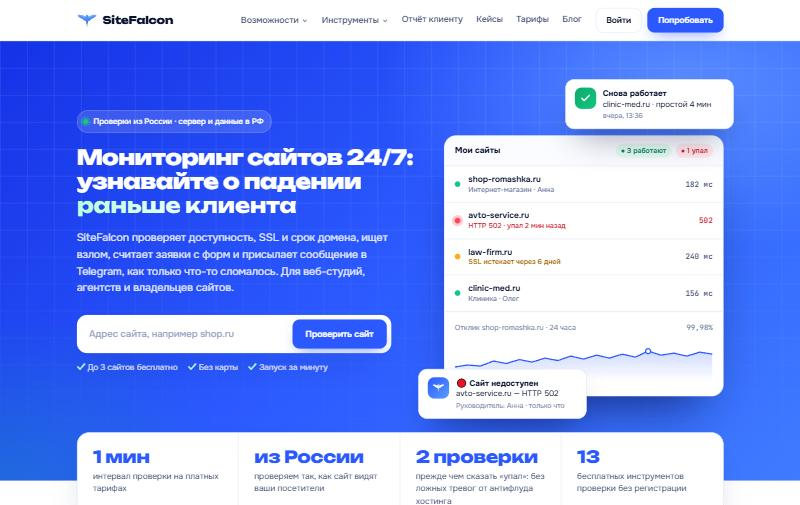
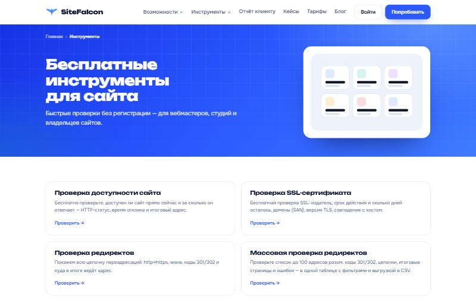
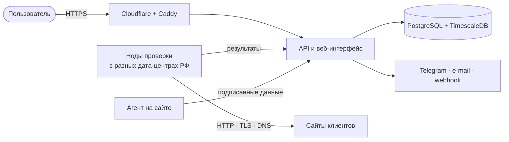

  <a href="https://sitefalcon.ru"><b>sitefalcon.ru</b></a> ·
  <a href="https://sitefalcon.ru/tools/">Бесплатные инструменты</a> ·
  <a href="https://sitefalcon.ru/pricing/">Тарифы</a> ·
  <a href="https://sitefalcon.ru/blog/">Блог</a>

  
  

**SiteFalcon** — сервис мониторинга сайтов. Проверяет доступность, SSL и срок домена, ищет следы взлома, считает заявки с форм и сразу пишет в Telegram, если что-то сломалось. Для веб-студий, агентств, фрилансеров и владельцев сайтов.

> Это витрина проекта: описание, возможности и устройство. Исходный код закрыт.

## Возможности

**Доступность**
- Проверка каждую минуту с серверов в России — так, как сайт видят посетители
- Две проверки, прежде чем сказать «упал»: без ложных тревог от антифлуда хостинга
- Время ответа по фазам: DNS, TCP, TLS, первый байт
- Журнал инцидентов, процент доступности, графики отклика

**SSL, домен, DNS**
- Срок SSL-сертификата и регистрации домена — напоминания за 30, 14, 7, 3 и 1 день
- Контроль DNS-записей, проверка блокировки по реестру РКН

**Безопасность**
- Ежедневный поиск чужих редиректов, дефейса, спам-ссылок и открытых опасных файлов

**Формы и заявки**
- Находит формы на сайте и считает отправки: видно, если форма начала отдавать ошибку или заявки прекратились

**Отчёты и уведомления**
- Telegram, e-mail, webhook
- Статус-страница и отчёт клиенту под брендом студии
- Контроль фоновых задач (cron, обмен с 1С)

**Бесплатные инструменты без регистрации**
- Доступность, SSL, редиректы (в том числе массово), почта SPF/DKIM/DMARC, заголовки безопасности, DNS, скорость, мета-теги, whois, блокировка РКН, проверка на взлом, robots.txt и sitemap, «кто хостит сайт»

## Как устроено

| Часть | Технологии |
|---|---|
| Хранение метрик | PostgreSQL + TimescaleDB |
| Инфраструктура | Docker Compose, Caddy (HTTPS, rate limit), Cloudflare |
| Проверки | Распределённые ноды, Playwright для скриншотов страниц |
| Интеграции | Telegram Bot API, Google PageSpeed Insights, IndexNow, Robokassa |
| Безопасность | 2FA (TOTP), защита от перебора и SSRF, ежедневные бэкапы базы |

## Автор

**Никита Витченко** — идея, продукт и разработка. 
Telegram: [@EnotikNik](https://t.me/EnotikNik) · [info@sitefalcon.ru](mailto:info@sitefalcon.ru)

---

© 2026 Никита Витченко. Все права защищены.
